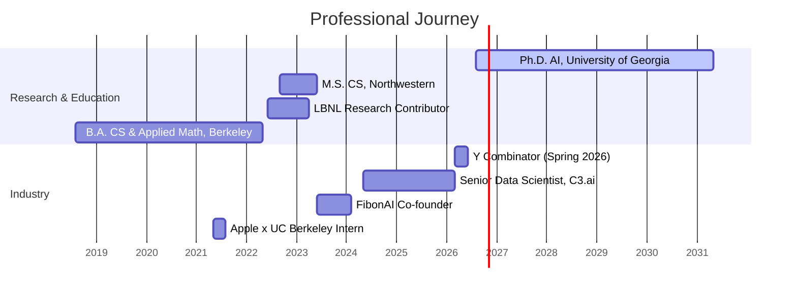

<div align="center">

# 👋 Hey, I'm Abel Yagubyan

### Ph.D. Student in AI @ University of Georgia | Trustworthy AI Evaluation | Y Combinator S26

[](https://abelo9996.github.io)
[](https://scholar.google.com/citations?user=rgd3iYwAAAAJ&hl=en)
[](https://orcid.org/0009-0004-8213-2863)
[](https://linkedin.com/in/abelyagubyan)
[](mailto:abelyagubyan@gmail.com)

</div>

---

## 🛠️ Building

- **[LearnOS](https://github.com/Abelo9996/LearnOS)** [](https://github.com/Abelo9996/LearnOS) - Self-hosted, open-source AI university: agents that build personalized roadmaps, tutor in real time, and grade toward mastery. One OpenRouter key, any model.
- **[rerun-bench](https://github.com/Abelo9996/rerun-bench)** [](https://github.com/Abelo9996/rerun-bench) - Replay your own repo's past bug fixes on your coding agent, several times each, and see where it is reliable and where it is a coin flip.
- **[nerf-watch](https://github.com/Abelo9996/nerf-watch)** [](https://github.com/Abelo9996/nerf-watch) - See what loads into every coding agent session before you type, cut what you never use, and catch silent regressions from your own logs.
- **[snap-back](https://github.com/Abelo9996/snap-back)** [](https://github.com/Abelo9996/snap-back) - Undo what your coding agent did, including what built-in checkpoints miss: overwritten .env files, deleted untracked files, and shell side effects.
- **[agent-fence](https://github.com/Abelo9996/agent-fence)** [](https://github.com/Abelo9996/agent-fence) - One permission policy for every coding agent: replay your existing logs against it, then block force pushes, secret reads and rm -rf for real.
- **[eval-builder](https://github.com/Abelo9996/eval-builder)** [](https://github.com/Abelo9996/eval-builder) - Is your LLM judge a coin flip? Tests it for position bias, flip-flopping and padding bias with no labels, then turns your real logs into an eval suite.
- **[paper-repro](https://github.com/Abelo9996/paper-repro)** [](https://github.com/Abelo9996/paper-repro) - Point your agent at a paper. It reruns the claim and gives you a verdict with receipts, or tells you exactly why it couldn't.
- **[train-doctor](https://github.com/Abelo9996/train-doctor)** [](https://github.com/Abelo9996/train-doctor) - Finds the bottleneck in a slow training run, tries the fixes, and keeps only speedups it can prove with the loss unchanged.
- **[browser-port](https://github.com/Abelo9996/browser-port)** [](https://github.com/Abelo9996/browser-port) - Turn an open-source C/C++ SDL game into a link anyone can play, in one command. [Play the demos](https://abelo9996.github.io/browser-port/)
- **[web-revive](https://github.com/Abelo9996/web-revive)** [](https://github.com/Abelo9996/web-revive) - Bring a dead Flash or Java web game back from its old URL as a playable link. [Play the demos](https://abelo9996.github.io/web-revive/)
- **[open-agent-lab](https://github.com/Abelo9996/open-agent-lab)** [](https://github.com/Abelo9996/open-agent-lab) - Independent, reproducible evaluation of coding agents: same tasks, many runs, intervals shown.

More: [notebook-to-pipeline](https://github.com/Abelo9996/notebook-to-pipeline) · [launch-day-kit](https://github.com/Abelo9996/launch-day-kit) · [Synthora](https://github.com/Abelo9996/Synthora) · [TableSage](https://github.com/Abelo9996/TableSage)

---

## 🧩 Contributing to

- **[REA: Reverse Engineer Anything](https://github.com/morluto/rea)** [](https://github.com/morluto/rea) - Android DEX static values through the JADX bridge, Mach-O segment and section name parsing, adb integer intent extras, and precise input errors for byte entropy windows, regex patterns, plist symlink loops, gRPC-web decoding and CDP targets.
- **[Headroom](https://github.com/headroomlabs-ai/headroom)** [](https://github.com/headroomlabs-ai/headroom) - Keep indented lines intact in OpenAI whitespace normalization so cached prompts stay byte-identical, and accept multi-line inline tables in Codex config.toml.
- **[OmniRoute](https://github.com/cheaper-inference/OmniRoute)** [](https://github.com/cheaper-inference/OmniRoute) - Keep commentary history in native OpenAI-compatible Responses passthrough, and add Cloudflare Workers AI context windows so combos advertise the right limit.
- **[llmfit](https://github.com/AlexsJones/llmfit)** [](https://github.com/AlexsJones/llmfit) - Keep the registry VRAM reading on Windows when PowerShell exits non-zero.
- **[dbx](https://github.com/t8y2/dbx)** [](https://github.com/t8y2/dbx) - SQL Server max string and rowversion mapping for cross-database transfer, correct sorting of WITH query results, and clause keyword ranking in SQL completion.
- **[oMLX](https://github.com/jundot/omlx)** [](https://github.com/jundot/omlx) - Show remote rank output when a cluster rank exits, and answer DiffusionGemma's vision tower check in the oQ sanitize proxy.
- **[CodexBar](https://github.com/steipete/CodexBar)** [](https://github.com/steipete/CodexBar) - Show the Cursor X Subscription weekly pool as the main meter. Credited in the 0.79.1 changelog.
- **[Mastering Agentic AI Systems (GSA)](https://github.com/GSA/MasteringAgenticAISystems_supplementals)** [](https://github.com/GSA/MasteringAgenticAISystems_supplementals) - Built the Ch 3.2 repeated-trial reliability lab (data generator, starter code, exercises, solution, self-check) and added paired significance tests to the Ch 3.1 and 3.2 comparison examples.
- **[Docling](https://github.com/docling-project/docling)** [](https://github.com/docling-project/docling) - In review: fall back from bfloat16 on devices without native support in the VLM pipeline.
- **[Dify](https://github.com/langgenius/dify)** [](https://github.com/langgenius/dify) - In review: route API-based extension requests through the SSRF proxy, and refresh the summary index when a duplicate document is re-uploaded.
- **[Kilo Code](https://github.com/Kilo-Org/kilocode)** [](https://github.com/Kilo-Org/kilocode) - In review: keep grep working on lines over 64 KiB, and validate the whole file before kilo import writes anything.
- **[oh-my-pi](https://github.com/can1357/oh-my-pi)** [](https://github.com/can1357/oh-my-pi) - In review: expand @path imports in APPEND_SYSTEM.md and SYSTEM.md.
- **[TruLens (Snowflake)](https://github.com/truera/trulens)** [](https://github.com/truera/trulens) - Area Triager, listed in [MAINTAINERS.md](https://github.com/truera/trulens/blob/main/MAINTAINERS.md). OpenTelemetry streaming metrics (TTFT, throughput), Jury reliability metadata, and correctness fixes across the database layer, OTEL instrumentation, providers and dashboard.
- **[inspect_evals (UK AI Security Institute)](https://github.com/UKGovernmentBEIS/inspect_evals)** [](https://github.com/UKGovernmentBEIS/inspect_evals) - Migrated metric helpers to inspect_ai's aggregate() and unscored reasons to Score.reason, plus eval scoring and docs fixes. Credited in releases v0.20.0, v0.22.0 and v0.25.0.

---

## 🚀 About Me

```python
class AbelYagubyan:
    def __init__(self):
        self.current_role = "Ph.D. Student in Artificial Intelligence @ University of Georgia"
        self.building = "LearnOS, an open-source agentic AI university"
        self.location = "San Francisco, CA"
        self.education = {
            "phd": "Ph.D. Artificial Intelligence @ University of Georgia (2026 - present)",
            "masters": "M.S. Computer Science @ Northwestern (Summa Cum Laude)",
            "bachelors": "B.A. Computer Science & Applied Math @ UC Berkeley",
        }
        self.research = [
            "LLM-as-a-judge reliability",
            "LLM agent reproducibility",
            "Evaluation science",
            "Open-source LLM evaluation tooling",
        ]

    def achievements(self):
        return {
            "accelerator": "Y Combinator, Spring 2026 batch",
            "papers": "4 published (GroundLM @ EMNLP 2026, MNRAS 2022, ACM SIGCSE 2022)",
            "citations": "45, incl. Meta Superintelligence Labs and Alibaba",
            "peer_review": "196 reviews across 9 Elsevier AI journals",
            "open_source": "Area Triager @ TruLens (Snowflake), contributor @ UK AISI inspect_evals",
            "industry": "Senior Data Scientist @ C3.ai, Co-founder @ FibonAI (Berkeley SkyDeck)",
        }
```

---

## 📄 Research & Publications

| Year | Paper | Venue | Cited by |
|:---:|---|---|:---:|
| 2026 | [**The Coin Flip Judge? Reliability and Bias in LLM-as-a-Judge Evaluation**](https://arxiv.org/abs/2606.13685) (sole author) | GroundLM 2026 @ EMNLP 2026, Archival Long Paper | 16 (incl. [Meta Superintelligence Labs](https://arxiv.org/abs/2608.08775)) |
| 2026 | [**How Consistent Are LLM Agents? Measuring Behavioral Reproducibility in Multi-Step Tool-Calling Pipelines**](https://arxiv.org/abs/2605.28840) (sole author) | arXiv preprint | 10 (incl. [Alibaba](https://arxiv.org/abs/2608.09290)) |
| 2022 | [**The Lick Observatory Supernova Search follow-up program: photometry data release of 70 SESNe**](https://doi.org/10.1093/mnras/stac723) (Zheng, Stahl, Filippenko, et al.) | MNRAS, vol. 512 | 19 |
| 2022 | **Embedding of Programming IDEs into Computer-Based Testing Software** (Yagubyan, Garcia) | ACM SIGCSE '22 | 0 |

**Peer review:** 196 verified reviews across nine Elsevier journals, including *Engineering Applications of Artificial Intelligence*, *Image and Vision Computing*, *Neural Networks*, and *Information Fusion*. See my [ORCID record](https://orcid.org/0009-0004-8213-2863).

---

## 💻 Tech Stack

### Languages


### AI/ML & LLMs


### Frameworks, Cloud & Infra


### HPC & Parallel Computing


---

## 🏆 Highlights

<table>
  <tr>
    <td align="center" width="33%">
      
      <br />
      <b>Spring 2026 Batch</b>
      <br />
      <sub>Startup accelerator</sub>
    </td>
    <td align="center" width="33%">
      
      <br />
      <b>Archival Long Paper</b>
      <br />
      <sub>Sole author, Budapest</sub>
    </td>
    <td align="center" width="33%">
      
      <br />
      <b>Elsevier Recognised Reviewer</b>
      <br />
      <sub>Nine AI and vision journals</sub>
    </td>
  </tr>
  <tr>
    <td align="center" width="33%">
      
      <br />
      <b>Area Triager</b>
      <br />
      <sub>Snowflake, 30 merged PRs</sub>
    </td>
    <td align="center" width="33%">
      
      <br />
      <b>M.S. Computer Science</b>
      <br />
      <sub>Northwestern University</sub>
    </td>
    <td align="center" width="33%">
      
      <br />
      <b>Research Contributor</b>
      <br />
      <sub>UPC++ performance, Pagoda Project</sub>
    </td>
  </tr>
</table>

---

## 🌟 Experience Timeline



---

## 📊 GitHub Activity

<div align="center">

[](https://github.com/Abelo9996)

</div>

---

## 📫 Let's Connect

I'm always interested in collaborating on:
- ⚖️ Evaluation science: making LLM judges and agents measurably reliable
- 🧩 Open-source LLM evaluation and observability tooling
- 🎓 Agentic systems for education
- 💡 Early-stage AI startups

<div align="center">

### 📧 [abelyagubyan@gmail.com](mailto:abelyagubyan@gmail.com)

**🌐 [Visit my portfolio](https://abelo9996.github.io) to learn more about my work!**

---

*"A judge that flips a coin is not a judge. Measure it."*

</div>
